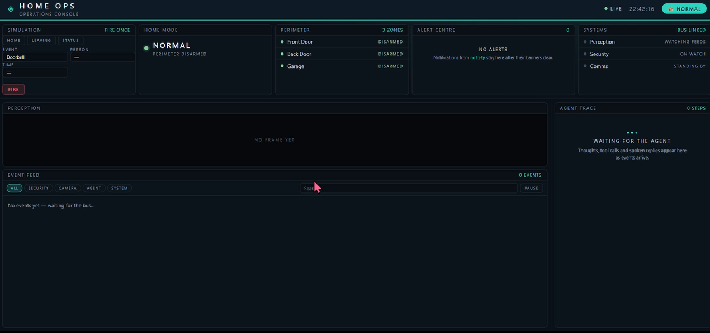
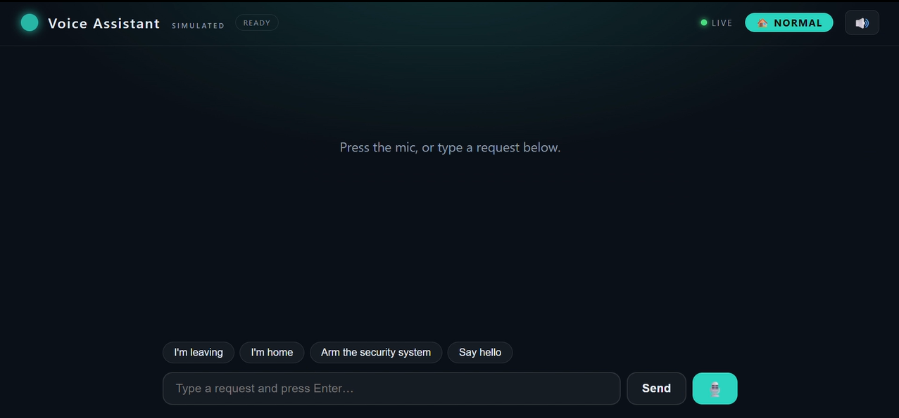
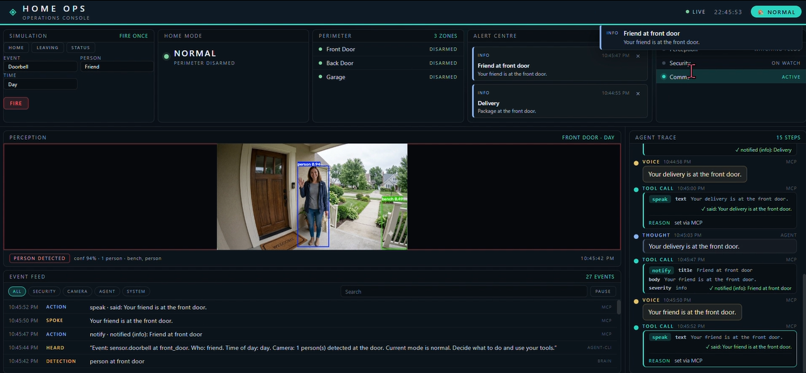
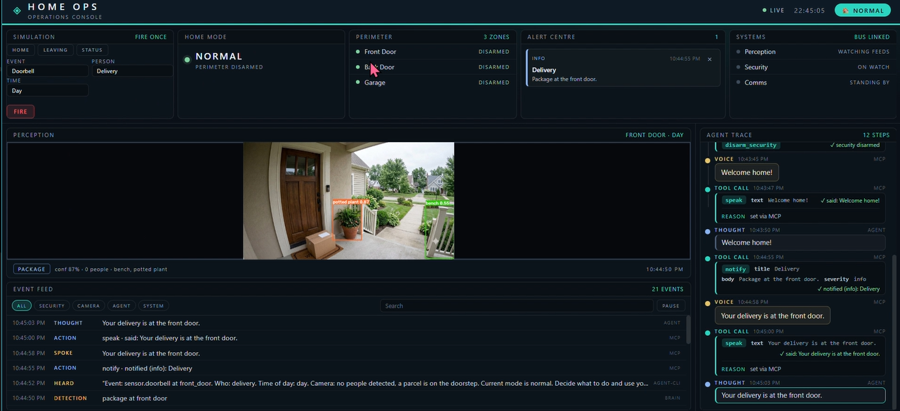
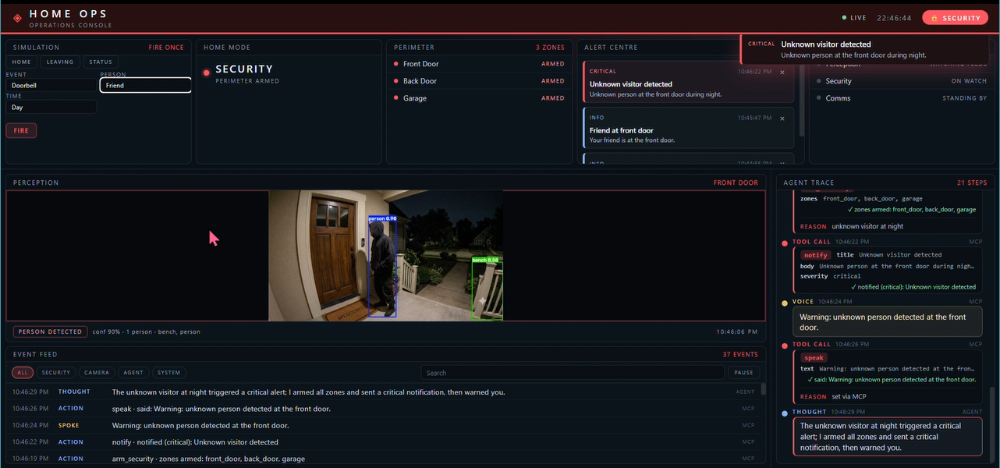
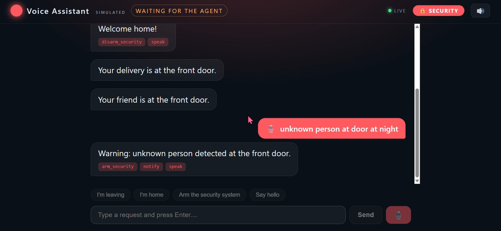
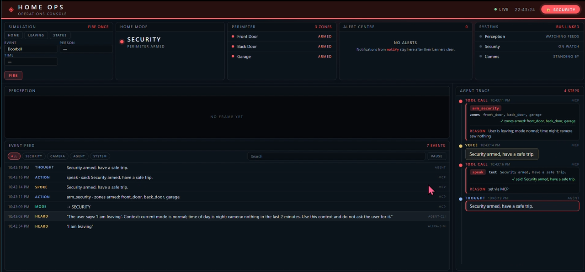
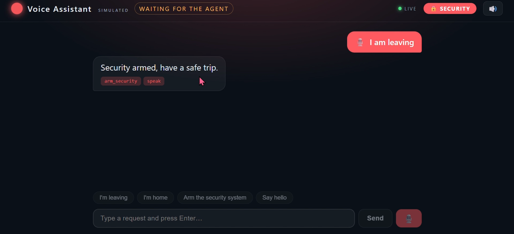
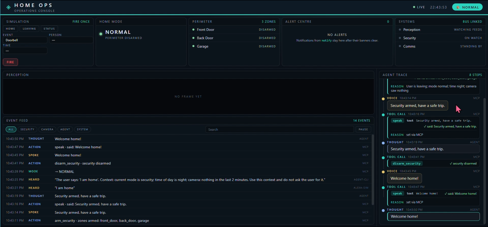
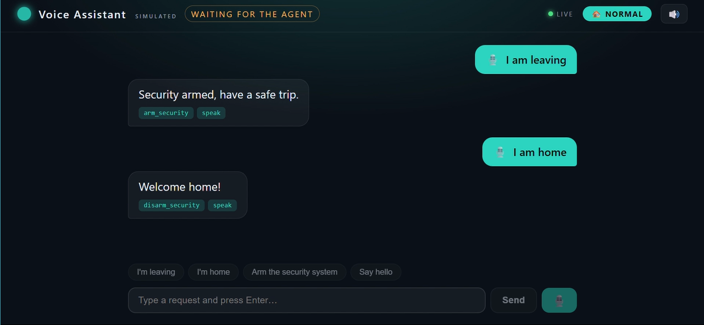

# HOME OPS

**One agent that sees your home's events, reasons about them, and acts, with its reasoning shown live on a TV-style console.**

Smart homes are a pile of disconnected apps: a doorbell rings in one, the camera clip sits in another, and nothing turns an event into an action. HOME OPS is the missing brain. Events (a voice request, a doorbell press, a camera frame, a terminal command) flow through one bus. An agent reasons over them with live context (mode, time of day, what the camera saw) and acts **only through MCP tools**.

The same doorbell event leads to different outcomes depending on the situation:

| Situation | What the agent does |
|---|---|
| Delivery, daytime | Info alert + spoken note, mode unchanged |
| Friend at the door, daytime | Info alert + greeting, mode unchanged |
| Unknown person, daytime, normal mode | Warning alert, mode unchanged |
| Unknown person at night (or while armed) | Critical alert, arms all zones, spoken warning |

## Hackathon entry

- **Primary track: Alexa+.** A self-hosted MCP server (FastMCP, Streamable HTTP, protocol 2025-11-25 negotiated) exposes the home tools, and the agent calls them as an MCP client. The Alexa+ experience itself is **simulated** in a web app (`console/assistant.html`, voice and text); we had no Alexa+ device to test on.
- **Mini challenge: AWS Builder.** The agent is built on the Strands Agents SDK (open source, from AWS).
- **Mini challenge: Open Source.** MIT licensed.
- The Fire TV / Vega track was dropped. The Vega SDK would not run on our development machine (see `docs/FRICTION_LOG.md`).
- The porch images in `samples/` are **AI-generated**. Vision runs on them with a local YOLO model.

## Architecture

```
 Voice assistant sim (web) ─┐
 homeops CLI ───────────────┤
 event sim (doorbell) ──────┼─►  Event bus (FastAPI + SSE)  ◄──►  Brain (listens, adds context)
 camera frame + YOLO ───────┘          │                               │
                                       ▼                               ▼
                           Web TV console (React)           Agent (Strands + Groq/Gemini)
                           reasoning, camera, alerts                   │ MCP client
                                                                       ▼
                                                    MCP server (FastMCP, Streamable HTTP)
                                                    tools: set_mode, arm_security,
                                                    disarm_security, speak, notify
```

MCP tools: `set_mode`, `arm_security`, `disarm_security`, `speak`, `notify`. Every tool call also posts an `agent.action` event so the console can show it.

Why two Python environments: `strands-agents` requires `mcp<2.2` while `fastmcp` needs `mcp` 2.x. The two sides only talk over HTTP, so they live in separate environments (details in the friction log).

## Setup

Requirements: Python 3.10+, Node 18+, a free Groq API key (or a Gemini key).

```bash
# 1) Bus, MCP server, CLI, tests
python3 -m venv .venv && source .venv/bin/activate
pip install -e ".[server,dev]"
# if importing fastmcp fails with "cannot import name 'SSEError' from 'httpx'":  pip install -U mcp

# 2) Agent, brain, vision (separate environment)
python3 -m venv venv-agent
venv-agent/bin/python -m pip install torch torchvision --index-url https://download.pytorch.org/whl/cpu
venv-agent/bin/python -m pip install -e ".[agent,perception]"

# 3) Console
cd console && npm install && cd ..

# 4) Keys
cp .env.example .env     # then add GROQ_API_KEY
```

## Run (four terminals, from the repo root)

```bash
# 1. event bus
source .venv/bin/activate && uvicorn homeops.bus:app --port 8000
# 2. MCP server
source .venv/bin/activate && homeops-mcp
# 3. brain (listens to the bus and runs the agent)
venv-agent/bin/python -c "from homeops.brain import main; main()"
# 4. console
cd console && npm run dev
```

Open `http://localhost:5173` (console) and `http://localhost:5173/assistant.html` (voice assistant simulation, Chrome recommended).

## Try it

```bash
homeops home
homeops sim doorbell --who delivery --when day
homeops sim doorbell --who friend --when day
homeops sim doorbell --who unknown --when night   # critical alert, arms security
homeops leaving
homeops status
homeops watch                                      # live event stream
```

Or use the assistant page: "I'm leaving", "I'm home", "stranger at the door at night", "who's at the door?".

Each agent run uses about 3 to 5 LLM requests, so free-tier limits apply.

## Screenshots

### Main Dashboard
HomeOps Dashboard — Live home monitoring, events, and security status.


### Voice Assistant
HomeOps Voice Assistant — Interact with the home agent using voice or text.


### Visitor and Delivery Scenarios
Friend Arrival — Handling a known visitor at the door.


Package Delivery — Handling a delivery visitor.


Unknown Visitor — Dashboard — Dashboard response to an unknown visitor.


Unknown Visitor — Voice Assistant — Voice assistant response to an unknown visitor.


### Home and Away Modes
Dashboard view when leaving home.


Assistant interaction for leaving home.


Dashboard view when returning home.


Assistant interaction for returning home.


## Project layout

- `src/homeops/bus.py`: event bus (FastAPI, SSE)
- `src/homeops/mcp_server.py`: MCP server and tools
- `src/homeops/agent.py`: Strands agent (MCP client, decision rules)
- `src/homeops/brain.py`: subscribes to the bus, adds context, runs the agent
- `src/homeops/perception.py`: local YOLO detection
- `src/homeops/cli.py`: the `homeops` command
- `console/`: React console and the assistant simulation page
- `tests/`: unit tests (`pytest`, no network or LLM needed)
- `docs/FRICTION_LOG.md`: problems we hit with the tools

## License

MIT
